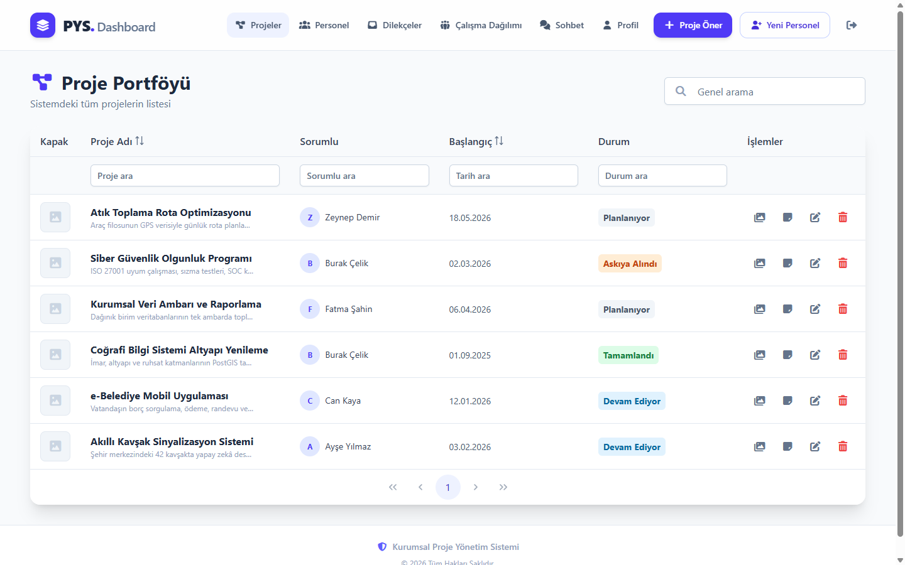
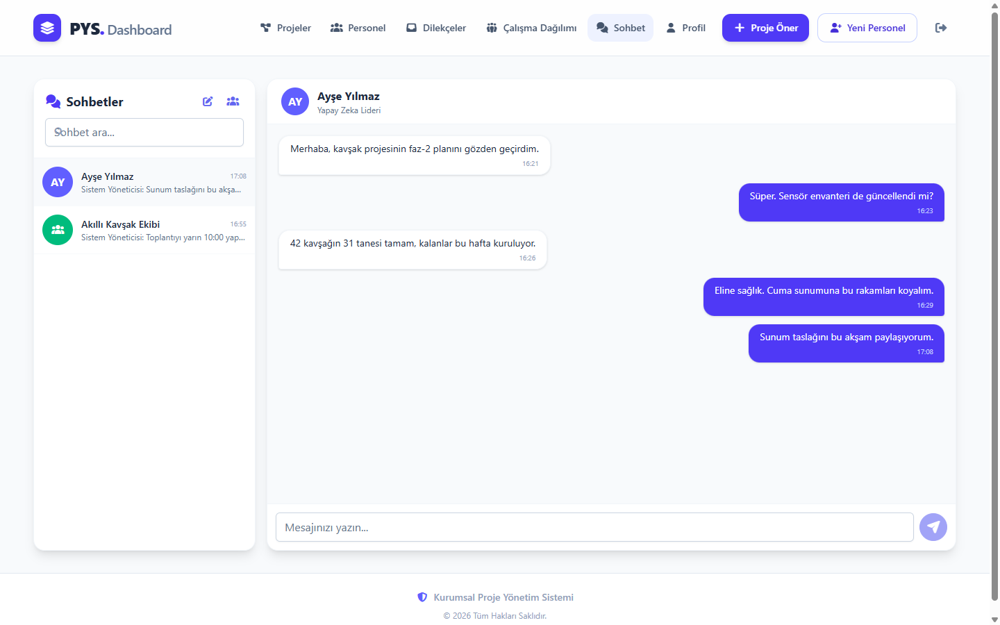
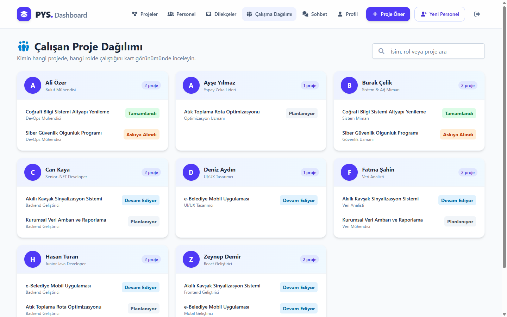
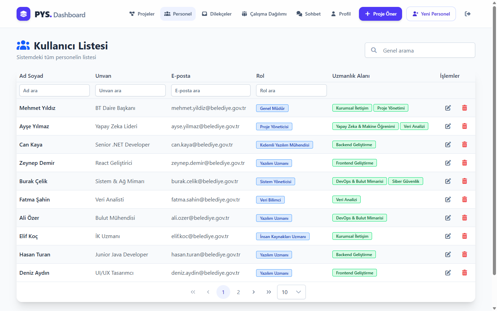
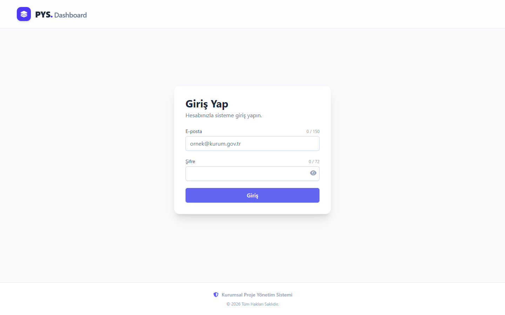
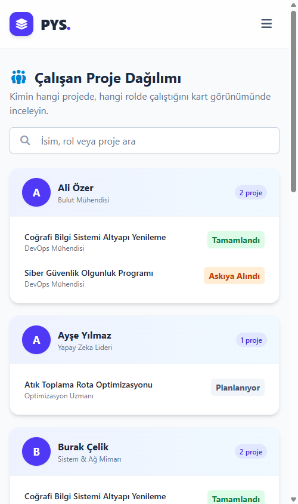

# PYS — Proje Yönetim Sistemi (Frontend)

Belediye yazılım ekibinin **proje, personel, doküman, dilekçe ve sohbet** akışını tek panelden yöneten Angular uygulaması.

Rol tabanlı yetkilendirme (Admin / Personel), JWT oturum yönetimi ve SignalR ile gerçek zamanlı mesajlaşma içerir.
Backend ayrı bir depodadır: **[PYS — ASP.NET Core Web API](https://github.com/YusufGUNEL/PYS)**


<p align="center">
  
</p>

<table>
  <tr>
    <td width="50%"></td>
    <td width="50%"></td>
  </tr>
  <tr>
    <td align="center"><sub>Gerçek zamanlı sohbet (SignalR)</sub></td>
    <td align="center"><sub>Çalışan proje dağılımı</sub></td>
  </tr>
  <tr>
    <td></td>
    <td></td>
  </tr>
  <tr>
    <td align="center"><sub>Personel listesi (filtre + sayfalama)</sub></td>
    <td align="center"><sub>Giriş</sub></td>
  </tr>
</table>

<p align="center">
  <br>
  <sub>Mobil görünüm — açılır menü ve yığılan kartlar</sub>
</p>

---

## Öne Çıkanlar

|                                       |                                                                                                                                                                                     |
| ------------------------------------- | ----------------------------------------------------------------------------------------------------------------------------------------------------------------------------------- |
| **Rol tabanlı erişim**                | Rotalar `authGuard` / `adminGuard` / `nonAdminGuard` ile korunur; menü, `AuthService` signal'larına göre kendini kurar.                                                             |
| **Oturum güvenliği**                  | JWT `localStorage`'da tutulur, **2 saatlik istemci tavanı** uygulanır (sunucu süresi daha uzun olsa bile), süre dolunca otomatik çıkış yapılır, 401'de interceptor oturumu kapatır. |
| **Gerçek zamanlı sohbet**             | SignalR hub'ı üzerinden bireysel/grup mesajlaşma, "yazıyor…" göstergesi, okundu bilgisi ve otomatik yeniden bağlanma.                                                               |
| **Tembel yükleme**                    | Her rota `loadComponent` ile ayrı parçaya bölünür — ilk yük **748 kB** (sıkıştırılmış ~171 kB).                                                                                     |
| **Kaydedilmemiş değişiklik koruması** | Form kirliyken sayfadan çıkışta `unsavedChangesGuard` onay ister.                                                                                                                   |
| **Erişilebilirlik**                   | Tüm form alanları etiketiyle eşleşir, ikon butonlarının erişilebilir adı vardır, liste öğeleri klavyeyle gezilebilir (`angular-eslint` a11y kuralları CI'da zorunlu).               |

## Teknoloji Yığını

- **Angular 21** — standalone bileşenler, `inject()`, signal'lar, `@if`/`@for` blok sözdizimi, fonksiyonel guard ve interceptor'lar
- **PrimeNG 21** + **TailwindCSS 4** — arayüz (Aura teması, marka rengine göre özelleştirilmiş)
- **@microsoft/signalr** — gerçek zamanlı sohbet
- **RxJS** — reaktif servis katmanı
- **Vitest** + `HttpTestingController` — birim testler
- **ESLint (angular-eslint)** + **Prettier** — kod kalitesi

## Rotalar ve Yetkiler

| Rota               | Bileşen                   | Erişim                                                       |
| ------------------ | ------------------------- | ------------------------------------------------------------ |
| `/login`           | `LoginComponent`          | Herkes                                                       |
| `/projects`        | `ProjectListComponent`    | Girişi olan (admin tümünü, personel kendi projelerini görür) |
| `/project-add`     | `ProjectAddComponent`     | Girişi olan                                                  |
| `/profile`         | `ProfileComponent`        | Girişi olan                                                  |
| `/chat`            | `ChatComponent`           | Girişi olan                                                  |
| `/users`           | `UserListComponent`       | Yalnızca Admin                                               |
| `/user-add`        | `UserAddComponent`        | Yalnızca Admin                                               |
| `/project-workers` | `ProjectWorkersComponent` | Yalnızca Admin                                               |
| `/petitions`       | `PetitionsAdminComponent` | Yalnızca Admin                                               |
| `/my-petitions`    | `MyPetitionsComponent`    | Yalnızca personel                                            |

Rota korumalarının doğruluğu `src/app/app.routes.spec.ts` içindeki testlerle sürekli denetlenir.

## Proje Yapısı

```
src/app/
├── components/      # Her ekran için bir klasör (.ts + .html [+ .css])
├── services/        # API istemcileri, auth durumu, SignalR
├── guards/          # authGuard, adminGuard, nonAdminGuard, unsavedChangesGuard
├── models/          # HTTP sözleşmeleri (DTO arayüzleri)
├── shared/          # Doğrulayıcılar, durum→renk eşlemesi gibi ortak yardımcılar
├── environments/    # Ortam ayarları (API adresi çalışma zamanında okunur)
├── app.routes.ts    # Tembel yüklenen rota tanımları
└── app.config.ts    # Sağlayıcılar: router, http+interceptor, PrimeNG teması
```

## Kurulum

**Gereksinimler:** Node.js 20.19+ · npm 11+ · çalışan PYS Backend API'si (varsayılan `http://localhost:5058`)

> Backend'in bağlantı dizesi, MinIO anahtarları ve JWT imza anahtarı depoda tutulmaz.
> `appsettings.Local.json.example` dosyasını `appsettings.Local.json` olarak kopyalayıp doldurun
> (ayrıntı: backend README).

```bash
npm install
npm start          # http://localhost:4200
```

## Komutlar

| Komut             | Açıklama                            |
| ----------------- | ----------------------------------- |
| `npm start`       | Geliştirme sunucusu                 |
| `npm run build`   | Üretim derlemesi (`dist/`)          |
| `npm test`        | Vitest izleme modunda               |
| `npm run test:ci` | Testleri tek seferlik çalıştırır    |
| `npm run lint`    | ESLint (TypeScript + şablon + a11y) |
| `npm run format`  | Prettier ile biçimlendirir          |

## API Adresi Yapılandırması

API adresi **derleme sonrası** değiştirilebilir: `public/assets/env.js` dosyası çalışma zamanında okunur.

```js
// public/assets/env.js
window.__env = { apiUrl: 'http://localhost:5058' };
```

`environment.ts` bu değeri okur, bulunamazsa `http://localhost:5058` adresine düşer. Böylece aynı `dist/` çıktısı farklı sunuculara yeniden derlemeden dağıtılabilir — bu yüzden ayrı bir `environment.prod.ts` tutulmuyor.

## Test

```bash
npm run test:ci
```

98 test, 12 dosya. Kapsam: oturum yaşam döngüsü (süre tavanı, otomatik çıkış, önbellek penceresi), HTTP interceptor (başlık ekleme, 401 davranışı), üç rota guard'ı, rota koruma matrisi, servis uçları, form doğrulayıcıları, rol bazlı menü kurulumu ve mobil menü davranışı.

## Sürekli Entegrasyon

`.github/workflows/ci.yml` her push ve PR'da şu adımları çalıştırır:

`format:check` → `lint` → `test:ci` → `build`

Üretim derlemesi ayrıca **paket boyutu bütçesiyle** sınırlanmıştır (uyarı 850 kB, hata 1.2 MB); tembel yükleme bozulursa CI kırmızıya döner.

## Varsayılan Hesaplar (backend seed)

| E-posta                         | Şifre       | Rol      |
| ------------------------------- | ----------- | -------- |
| `admin@pys.local`               | `Admin123!` | Admin    |
| `mehmet.yildiz@belediye.gov.tr` | `123456`    | Personel |

> Bunlar yalnızca yerel geliştirme içindir; canlı ortamda ilk açılışta değiştirilmelidir.

## Lisans

MIT — bkz. [LICENSE](LICENSE).
